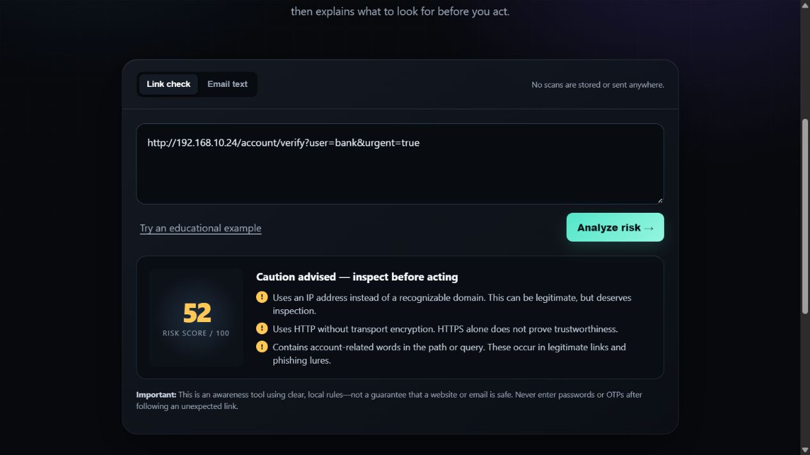

# PhishShield
### Pause. Inspect. Click smarter.

A browser-based phishing awareness tool that explains common warning signs in links and email text. Built with HTML, CSS, and JavaScript, with no runtime dependencies.



## Why I built this

Phishing often relies on pressure and confusing links. PhishShield makes common warning patterns visible so students can inspect a message and understand why it deserves attention.

## Features

- Separate link and email-text checks.
- Explainable warning scores with individual findings.
- HTTP/HTTPS URL validation and clear errors for empty or invalid input.
- URL checks for IP addresses, user information before `@`, long URLs, many hostname labels, encoded separators, account-related words, and internationalized domains.
- Email checks for urgency, authentication-secret mentions, threats, action prompts, and reward language.
- Educational examples, responsive design, keyboard focus indicators, and reduced-motion styling.
- Local processing: no scan history, analytics, external libraries, or network requests in the application code.

## Run locally

Open `dist/index.html` in your browser. Keep all four website files in `dist` together. No installation is required.

Alternatively, with Python installed, run this from the project folder:

```sh
python -m http.server 4173 --directory dist
```

Then visit `http://localhost:4173`.

## Try these examples

| Input | Mode | Expected result |
| --- | --- | --- |
| `https://example.com` | Link | 0; no configured patterns matched, safety remains unverified |
| `http://192.168.10.24/account/verify?user=bank&urgent=true` | Link | 52; IP address, HTTP, and account-related words |
| `https://trusted.example@attacker.example/` | Link | 25; actual host is attacker.example |
| `URGENT: Your account will be blocked today. Verify your password and OTP now.` | Email | 77; urgency, secrets, threat, and action prompt |

Examples are strings to analyze. The tool does not visit them.

## How scoring works

`dist/analyzer.js` parses URLs with the browser's URL parser and applies explicit weighted rules. Email analysis applies word-pattern rules. Each matched category contributes once, and scores are capped at 100.

- **0–24:** few warning patterns; safety is unverified.
- **25–54:** caution advised.
- **55–100:** high warning score; verify independently.

These thresholds and weights are manually chosen educational heuristics, not measured phishing probabilities. HTTPS, ordinary words, encoded paths, and internationalized domains can all appear in legitimate websites. A score of zero does not establish safety.

## Tests

Install Node.js 18 or newer, then run:

```sh
npm test
```

No package installation is needed. The 13 tests cover invalid input, deceptive user information, IPv6, hostname-versus-path handling, internationalized domains, case handling, email rules, and score limits. GitHub Actions runs them on pushes and pull requests.

If your environment prevents the test runner from starting child processes, run the same test file directly:

```sh
node tests/analyzer.test.cjs
```

## Project structure

```text
PhishShield/
├── dist/
│   ├── index.html             # Page structure
│   ├── styles.css             # Responsive styling
│   ├── analyzer.js            # Pure scoring and validation rules
│   └── app.js                 # UI interactions
├── tests/analyzer.test.cjs    # Rule tests
├── docs/preview.png           # Actual website screenshot
├── .github/workflows/tests.yml
├── .gitignore
├── package.json
├── LICENSE
└── README.md
```

Hosting-specific configuration is stored in `.openai/hosting.json`. It is not required to open the site locally.

## Limitations

This version does not inspect page content, follow redirects, check domain age, query threat-intelligence services, authenticate senders, analyze email headers, or detect every lookalike domain. Email checks cannot understand intent or negation; for example, a legitimate warning about passwords can match the secret-mention rule.

The tool supports full HTTP/HTTPS URLs with domain names or IP addresses, not local or single-word hostnames. It can produce false positives and false negatives. It is a learning project, not a replacement for security software or independent verification. No detection-accuracy claim has been established against a labeled dataset.

## Future improvements

- Evaluate against a licensed, labeled dataset and report precision and recall.
- Improve contextual email checks and registered-domain explanations.
- Add optional reputation checks with clear consent and privacy disclosures.

These are planned ideas, not current features.

## Contributing

Suggestions, reproducible bug reports, and focused pull requests are welcome. Describe the behavior, include a harmless example, and add a test when changing a rule. Avoid submitting passwords, OTPs, private emails, or live personal links.

## License

[MIT](LICENSE). You may reuse and modify the code under the license terms.
